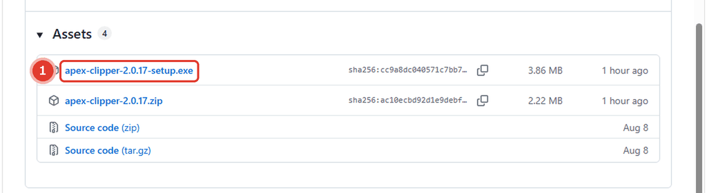
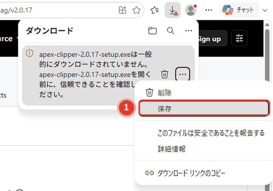
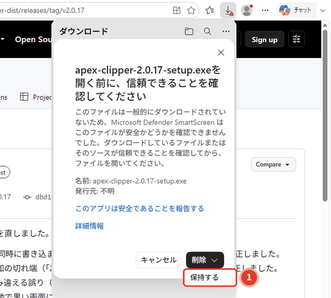
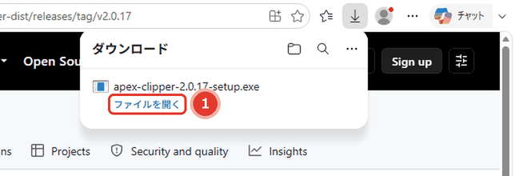
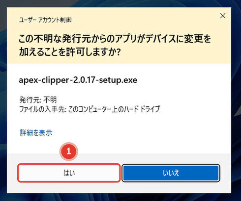
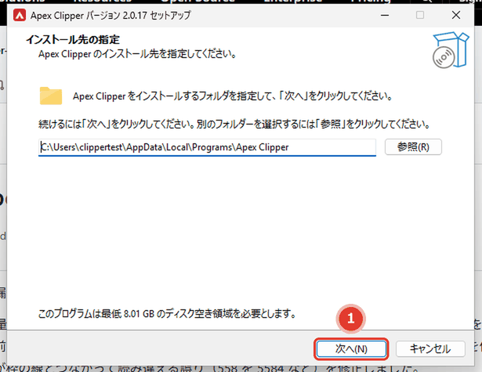
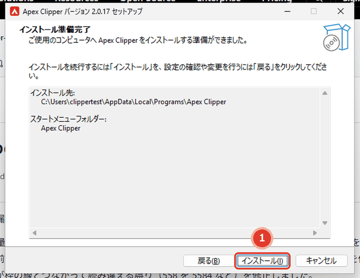
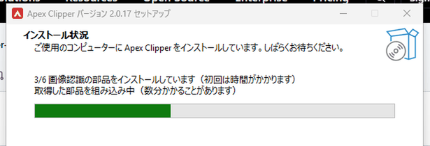
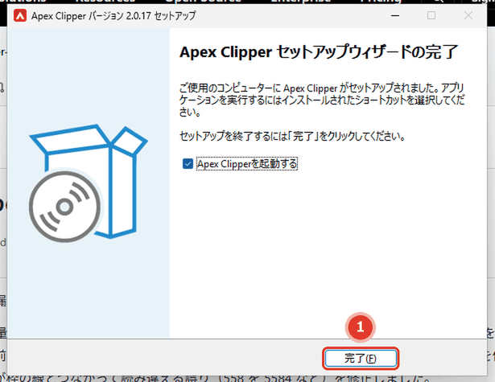
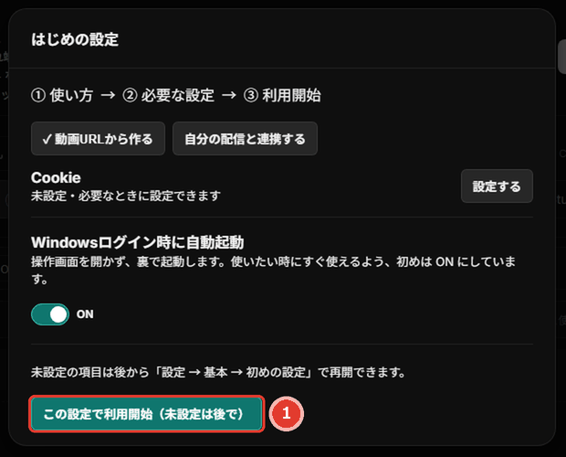

# Apex Clipper

配信の録画から、キルの場面だけを自動で抜き出してつなげる Windows のアプリです。

**▶ [最新版のダウンロードページ](https://github.com/Qmq-pkuma/apex-clipper-dist/releases/latest)**

## インストールの手順（画像つき）

下の画面は Windows 11 の Edge です（Chrome でも似た表示が出ます）。**赤い枠を、番号の順に押して**いけば進めます。
必要なもの：Windows 10 / 11・ネット回線・空き容量 50GB 以上（NVIDIA のグラフィックボードがあると速い）。

### 1. 最新版のページを開いて、setup.exe を選ぶ

[最新版のページ](https://github.com/Qmq-pkuma/apex-clipper-dist/releases/latest) を開き、下の「Assets」にある **①「apex-clipper-(版)-setup.exe」** を押します。ZIP ではなく、こちらです。

### 2. 「一般的にダウンロードされていません」と出たら

個人で作った（署名のない）アプリなので、Edge がこの表示を出します。ダウンロードの一覧の項目にマウスを載せると出る **①「…」** を押します（右クリックでも同じメニューが出ます）。

**①「保存」** を押します。

確認の窓が出ます。**①「削除」の右の「∨」** を押します。**「削除」の文字そのものは押さないでください**（ファイルが消えます。消えたらもう一度ダウンロード）。

**①「保持する」** を押します。

**①「ファイルを開く」** を押します。

### 3. Windows の確認で「はい」

「発行元: 不明」は、個人で作ったアプリのためです。**①「はい」** を押します。青い画面「Windows によって PC が保護されました」が出た時は「詳細情報」→「実行」。

### 4. セットアップを進める

インストール先は変えなくて大丈夫です。**①「次へ」** を押します。次の2ページも「次へ」です。

**①「インストール」** を押します。

「1/6」から「6/6」まで進みます。初回は部品のダウンロードで **15〜40分** かかることがあります。途中で失敗したら、同じ setup.exe をもう一度実行するとやり直せます。

### 5. 起動する

「Apex Clipperを起動する」にチェックが入ったまま **①「完了」** を押すと起動します。デスクトップに「Apex Clipper」のショートカットができます。

アプリの画面が出てから10〜20秒ほどで「はじめの設定」が出ます。最初は何も変えずに **①「この設定で利用開始」** で大丈夫です。使い方の案内は、アプリの右上の歯車 →「基本」→「案内を開く」にあります。

---

この置き場には配布物（ZIP・setup.exe）だけを置いています。ソースは含みません。
画面は、個人の設定やアカウントの無い試験用の Windows で撮ったものです。
